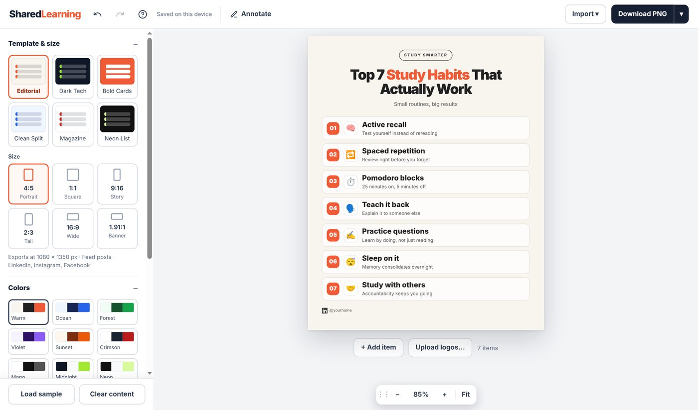

# SharedLearning

**A free, open-source Top-N graphic maker that runs entirely in your browser.**

Pick a template, edit right on the canvas, and export a crisp PNG, JPG or PDF sized for LinkedIn, Instagram, X or stories. No sign-up, no watermark, no backend.

- **Live site:** https://sharedlearning.online
- **Docs:** [`docs.html`](docs.html)



## Features

- **Edit on the canvas.** Click any text to type. Drag a number badge to reorder.
- **Six templates** (Editorial, Dark Tech, Bold Cards, Clean Split, Magazine, Neon List) and nine color palettes, or set your own colors.
- **Six sizes:** 4:5, 1:1, 9:16, 2:3, 16:9 and 1.91:1, exported at 2x. Long lists flow into columns on wide formats, and text auto-fits.
- **Real brand logos** via the Iconify API, plus emoji and your own images. One click matches every item.
- **49 typefaces** (47 open-source Google Fonts). Select part of a text to change just that selection's color and font.
- **Footer handles:** up to four, with platform icons, always on one line.
- **Annotations:** lines, arrows, boxes and circles that export with the graphic.
- **Import:** paste a list, paste or upload JSON, including JSON-RPC 2.0 envelopes for tool integrations.
- **Export:** PNG, JPG, PDF, copy to clipboard, or JSON for an editable backup.
- **Private:** work autosaves to your browser's local storage. No account, no analytics.
- **Responsive:** a canvas-first layout that works on phones.

## Quick start

There is no build step. It is plain static HTML.

```bash
git clone https://github.com/Mayoyo25/sharedlearning.git
cd sharedlearning
python3 -m http.server 8080
# open http://localhost:8080
```

Any static host works: GitHub Pages, Netlify, Cloudflare Pages, S3, or your own server. Keep the HTML files in the same folder, because they link to each other by relative path.

## Project structure

| File | What it is |
| --- | --- |
| `index.html` | Landing page and template gallery (previews are embedded images) |
| `editor.html` | The editor: one self-contained file with all CSS and JavaScript |
| `docs.html` | User and developer documentation |
| `LICENSE` | MIT license |

## Start from a template

`editor.html?start=KEY` opens a starter template. Keys: `habits`, `tools`, `books`, `courses`, `exam`, `focus`. If the visitor already has saved work, they are asked before it is replaced.

## JSON import

Only `items` is required.

```json
{
  "headline": "Top 5 Dev Tools",
  "subtitle": "What I use daily",
  "template": "dark",
  "palette": "midnight",
  "ratio": "4:5",
  "handles": [{ "platform": "linkedin", "text": "@yourname" }],
  "items": [
    { "title": "Notion", "description": "Docs and wikis", "icon": "auto" },
    { "title": "Figma", "icon": "logos:figma" },
    { "title": "Linear", "icon": "🚀" }
  ]
}
```

The same data can arrive inside a JSON-RPC 2.0 envelope (`params.arguments`, `params`, or `result`, including MCP-style `content[0].text` and `structuredContent`). See [`docs.html`](docs.html#import) for every key and value.

### Scripting

The editor exposes a small API on `window.ListGraphic`:

```js
await ListGraphic.load(jsonOrObject); // same formats as Import
ListGraphic.get();                     // current graphic as JSON
await ListGraphic.start('tools');      // load a starter template
```

## Dependencies

All loaded from public CDNs, with exact versions pinned in `editor.html`:

- [SortableJS](https://sortablejs.github.io/Sortable/) 1.15.2: drag to reorder
- [html2canvas](https://html2canvas.hertzen.com/) 1.4.1: image export
- [jsPDF](https://github.com/parallax/jsPDF) 2.5.1: PDF export
- [Google Fonts](https://fonts.google.com/): typefaces, loaded on demand
- [Iconify API](https://iconify.design/): brand-logo search

To run without CDNs, download the three libraries and change their `<script>` URLs in `editor.html`. Logo search and Google Fonts need network access.

## Privacy

Lists, images and annotations stay in your browser. The only network requests are for the libraries and fonts above, and for logo search, which sends the name you searched to the Iconify API.

## How it works

- Vanilla JavaScript in a single function scope with one `state` object, a 50-step undo history and autosave to `localStorage`.
- The graphic is a fixed-size element scaled with a CSS transform. Export renders a clone at its natural size at 2x.
- Inline text formatting is stored as sanitized HTML beside the plain text, and falls back to the plain text if they disagree.

## Contributing

Issues and pull requests are welcome. Before opening a PR:

1. Run the app locally and check your change at desktop and phone widths.
2. Test PNG and PDF export, since export uses a separate render path from the editor.
3. Keep it dependency-light: no build step, no frameworks.

Ideas that would be welcome: more templates, more platform icons, a text-box annotation, and keyboard-accessible drag reordering.

## Support

SharedLearning is free, with no ads and no paywall. If it saves you time, you can help cover hosting and maintenance:

- [Sponsor on GitHub](https://github.com/sponsors/Mayoyo25)
- [Support on Ko-fi](https://ko-fi.com/franklinmayoyo)
- Star the repo, share a graphic you made, or send a pull request.

## License

[MIT](LICENSE)

Brand logos shown by logo search belong to their respective owners. Typefaces are open source under their own licenses (SIL OFL or Apache 2.0).
